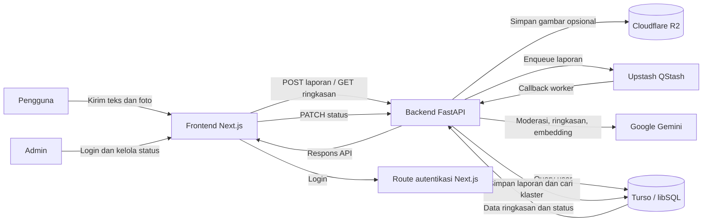

# FacyPort

FacyPort adalah platform pelaporan fasilitas kampus. Pengguna dapat mengirim laporan teks beserta foto, melihat ringkasan isu yang telah dikelompokkan, dan memantau status penanganannya. Admin memiliki dashboard untuk meninjau klaster dan memperbarui status.

## Fitur Utama

- Form laporan dengan unggahan foto opsional.
- Moderasi, peringkasan, kategorisasi, dan ekstraksi kata kunci menggunakan Google Gemini.
- Pengelompokan laporan serupa menggunakan embedding dan vector search di Turso.
- Antrean pemrosesan asynchronous menggunakan Upstash QStash.
- Penyimpanan gambar privat pada Cloudflare R2.
- Halaman publik untuk mencari dan memfilter ringkasan laporan.
- Dashboard admin dengan autentikasi dan pembaruan status laporan.

## Struktur Repository

```text
facyport/
├── backend/    # REST API FastAPI, pemrosesan AI, database, dan integrasi layanan
├── frontend/   # Aplikasi web Next.js untuk pengguna dan admin
└── README.md   # Panduan umum repository
```

Panduan setup dan rincian tiap aplikasi:

- [Dokumentasi Backend](./backend/README.md)
- [Dokumentasi Frontend](./frontend/README.md)

## Arsitektur Singkat



Alur laporan: pengguna mengirim teks dan foto melalui frontend; backend menyimpan foto ke R2 bila ada lalu memasukkan pekerjaan ke antrean QStash. QStash memanggil worker backend untuk memproses laporan dengan Gemini dan mencari klaster serupa di Turso. Backend membuat klaster baru atau memperbarui klaster yang cocok, kemudian frontend mengambil data klaster untuk ditampilkan kepada publik dan admin.

## Prasyarat

- **Node.js 20.9+** dan npm untuk frontend.
- **Python 3.14+** untuk backend.
- Database Turso/libSQL.
- Google Gemini API key.
- Upstash QStash token dan signing keys untuk alur callback.
- Kredensial Cloudflare R2 jika fitur unggah foto digunakan.

Layanan eksternal diperlukan untuk menjalankan seluruh alur. Untuk pengujian lokal, gunakan kredensial dan database khusus development/testing.

## Menjalankan Secara Lokal

### 1. Siapkan backend

Buka PowerShell di folder `backend`:

```powershell
py -3.14 -m venv venv
.\venv\Scripts\Activate.ps1
python -m pip install --upgrade pip
python -m pip install -e . "uvicorn[standard]" httpx
```

Buat `backend/.env.development.local` dan isi kredensial sesuai bagian environment pada [README backend](./backend/README.md). Siapkan tabel dan jalankan API:

```powershell
python migrate.py
python -m uvicorn main:app --reload
```

API lokal berjalan secara default di `http://127.0.0.1:8000`; dokumentasi interaktif tersedia di `/docs`.

### 2. Siapkan frontend

Buka terminal PowerShell lain di folder `frontend`:

```powershell
npm ci
```

Buat `frontend/.env.local` dan isi `TURSO_DATABASE_URL`, `TURSO_AUTH_TOKEN`, serta `JWT_SECRET` sesuai [README frontend](./frontend/README.md). Jalankan aplikasi:

```powershell
npm run dev
```

Frontend berjalan secara default di `http://localhost:3000`.

### Catatan koneksi lokal

Beberapa halaman frontend saat ini menggunakan URL backend deployment secara langsung, bukan URL yang diatur melalui environment variable. Karena itu, menjalankan backend lokal saja belum otomatis membuat frontend lokal menggunakannya. Ubah URL `fetch()` pada halaman terkait atau gunakan URL backend yang sesuai sebelum menguji integrasi lokal.

Pemrosesan QStash juga memerlukan URL backend yang dapat dijangkau dari internet. Worker tidak dapat menerima callback QStash ke `localhost` biasa; gunakan URL publik sementara yang aman untuk development atau backend deployment yang sudah dikonfigurasi.

## Environment

Variabel sensitif tidak boleh disimpan di repository atau dimasukkan ke dokumentasi. Buat file environment lokal masing-masing aplikasi:

### Backend — `backend/.env.development.local`

```dotenv
TURSO_DATABASE_URL=
TURSO_AUTH_TOKEN=
ADMIN_SECRET_KEY=
AI_API_KEY=
QSTASH_TOKEN=
APP_BASE_URL=
QSTASH_CURRENT_SIGNING_KEY=
QSTASH_NEXT_SIGNING_KEY=
CF_ACCOUNT_ID=
CF_R2_ACCESS_KEY_ID=
CF_R2_SECRET_ACCESS_KEY=
CF_R2_BUCKET_NAME=
```

`GEMINI_API_KEY` dapat digunakan sebagai alternatif `AI_API_KEY`. Kredensial R2 diperlukan untuk menyimpan gambar, sedangkan QStash diperlukan untuk menerima laporan melalui antrean.

### Frontend — `frontend/.env.local`

```dotenv
TURSO_DATABASE_URL=
TURSO_AUTH_TOKEN=
JWT_SECRET=
```

Lihat [README backend](./backend/README.md) dan [README frontend](./frontend/README.md) untuk penjelasan setiap variabel dan konfigurasi tambahan. Jangan pernah mengekspos secret melalui variabel `NEXT_PUBLIC_*`.

## Endpoint Utama

| Aplikasi | Method | Endpoint | Kegunaan |
|---|---|---|---|
| Backend | `GET` | `/health` | Memeriksa status backend dan koneksi Turso. |
| Backend | `POST` | `/api/reports` | Menerima laporan dan memasukkannya ke antrean. |
| Backend | `GET` | `/api/reports/{report_id}` | Mengambil detail laporan. |
| Backend | `GET` | `/api/summaries` | Mengambil seluruh klaster ringkasan. |
| Backend | `GET` | `/api/summaries/{summary_id}` | Mengambil satu klaster. |
| Backend | `PATCH` | `/api/summaries/{summary_id}/status` | Memperbarui status klaster; memerlukan token admin backend. |
| Backend | `GET` | `/api/categories` | Mengambil daftar kategori. |
| Frontend | `POST` | `/api/auth/login` | Login admin dan membuat cookie sesi. |
| Frontend | `POST` | `/api/auth/logout` | Menghapus cookie sesi admin. |

Endpoint worker backend `/api/worker/process-report` dipanggil oleh QStash, bukan oleh pengguna melalui browser. Detail request dan respons tersedia di dokumentasi masing-masing aplikasi.

## Pengujian dan Pemeriksaan

### Frontend

Dari folder `frontend`:

```powershell
npm run lint
npm run build
```

### Backend

Dari folder `backend`, dengan environment dan layanan eksternal yang sesuai:

```powershell
python test_ai_service.py
python test_report_flow.py
```

Skrip backend tersebut dapat memanggil Gemini dan mengubah data Turso. Jangan jalankan terhadap kredensial atau database produksi untuk pengujian. Baca panduan backend sebelum menjalankan skrip flush atau benchmark.

## Deployment

- Deploy `backend` sebagai layanan FastAPI yang dapat dijangkau QStash; atur `APP_BASE_URL` ke URL publik tersebut.
- Deploy `frontend` sebagai aplikasi Next.js dan atur environment server-side yang diperlukan.
- Pastikan backend mengizinkan origin frontend melalui CORS dan seluruh deployment menggunakan HTTPS.
- Konfigurasikan signing key QStash agar callback worker diverifikasi.
- Jalankan migrasi database terhadap target yang benar sebelum aplikasi digunakan.
- Jangan gunakan kredensial development, endpoint provisioning yang tidak terlindungi, atau variabel `NEXT_PUBLIC_*` untuk menyimpan secret.

## Catatan Keamanan

- Jangan commit file `.env`, token, API key, atau kredensial database.
- Batasi origin CORS backend untuk domain frontend yang sah pada production.
- Lindungi endpoint worker dengan verifikasi signature QStash dan jangan membiarkan callback tanpa autentikasi.
- Gunakan secret JWT yang kuat dan simpan hanya di environment server.
- Jangan mengekspos kredensial admin backend ke bundle browser.
- Operasi flush database dan bucket R2 bersifat destruktif. Pastikan targetnya environment disposable sebelum menjalankannya.
